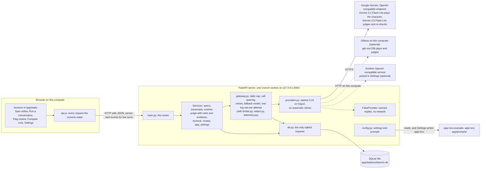

# Architecture

How the Character Consistency Workbench fits together for CP3. It runs on one computer: a browser page, one local server, one SQLite file, and the model service the creator picks in Settings. For setup, see [app/INSTALL.md](../app/INSTALL.md). For what each screen does, see [use-cases.md](use-cases.md).

## Diagram

There's no vector store: character.v1 sends the whole rendered spec on every turn, and the AI judge reads the whole chat in one call, so nothing needs retrieval yet. Memory and retrieval are CP4 work, to compare against this spec-only baseline.

## The parts

### Browser screens

`app/static/` holds the page: index.html, styles.css, api.js, and app.js. It started as a copy of the CP2 prototype, so it keeps the Material 3 look and the four tabs, one per journey step: Spec editor (Define), Run a conversation (Stress-test), Flag review (Diagnose), and Compare runs (Repair). The Settings dialog opens from the top bar.

- **In:** the creator's clicks and typing, and the server's JSON answers and streamed events.
- **Out:** HTTP requests. Every path lives in api.js, and app.js never calls `fetch`. Each request carries the tab's session ID in an `X-Workbench-Session` header. api.js makes the ID once per tab and keeps it in `sessionStorage`, so the server can apply the session limits and tell sessions apart in the event log.

The page loads Roboto and the Material Symbols icons from Google Fonts. Everything else comes from the local server.

### FastAPI server

`app/workbench/main.py` builds the app, serves the screens, and holds the routes. `app/run.sh` starts it as one process with one Uvicorn worker, on 127.0.0.1 port 8492 by default.

- **In:** HTTP requests from the page.
- **Out:** JSON answers whose shape is pinned by the Pydantic models in `schemas.py`, and a stream of server-sent events for each live turn: `user`, `wait`, `delta`, then `done` or `error`.

Routes only call services. A service error becomes a plain message with its status (404, 409, 422, 429, or 503), and a malformed request gets a message that names where it went wrong without echoing the request. The Settings routes answer only a browser on this computer.

At start, the server checks each file the prompt manifest lists against its recorded hash, applies any new database migrations, seeds spec v1, builds the provider, and adds an `app_settings` row if the settings changed since the last one. If something is wrong, run.sh prints one plain line that says what to fix, not a traceback.

### Services

Each service opens its own short database connection.

- **specs.py.** In: an edit from the Spec editor. Out: the next spec version, which never changes once saved. Also the spec as text for the models (`render_text`), and a warning when the setting is empty. Line IDs, line attributes, and check limits live in the spec itself, not in code.
- **transcripts.py.** In: a pasted chat, a file, or a sample. Out: a preview, then a saved chat that keeps the source's own numbering. It also saves each message of a live chat, redacted, and marks lines that read like instructions to the AI.
- **runtime.py.** In: Start run, the next scripted line, a typed line, or Stop. Out: streamed events and saved messages. The system message is character.v1 with the chat's pinned spec version rendered in. It's built once per chat, so its bytes are the same on every turn. One turn runs per chat at a time.
- **judge.py, rules.py, and evidence.py.** In: a saved chat. Out: rule flags from code alone, then the AI judge's flags that pass the evidence checks, a count of hidden flags, and what the judge couldn't check. One judge call covers the whole chat, and the saved check is reused until the chat or the judge settings change.
- **recheck.py.** In: a chat's saved check and the creator's optional question. Out: what changed for each flag it looked at again (kept, re-rated, withdrawn, or added), and the AI's answer.
- **review.py.** In: Show in context, Agree, Override, and Undo on Flag review. Out: one event row per call, and the review state: open calls, the rubber-stamp message, and flags where the re-check disagrees with the creator's call.
- **app_settings.py.** In: the Settings dialog as typed, from Test or Save. Out: Test makes one small call. Save writes the changes to app/.env and puts them in force with no restart. Each one adds an `app_settings` row, never a key.

### Gateway

`gateway.py` is the only path to a model.

- **In:** a role, a model, and messages.
- **Out:** streamed text, or a JSON answer checked against its Pydantic model, plus token counts. Exactly one `model_calls` row for each attempt, however it ends.

Before each attempt it checks the daily cap and waits for its call slot (`limiter.py`). It redacts every message first (`redact.py`). A 429 or a 5xx before the first token is tried again after a pause, then once on the fallback model that the models file names. A JSON answer that doesn't match its schema gets one more try. `telemetry.py` writes the rows. For the demo, `WORKBENCH_FORCE_MODEL_ERROR` or the busy switch in Settings makes attempts fail with a 429 without calling the service.

### Providers

`providers.py` is the only module that imports openai or httpx2. `OpenAIProvider` talks to any OpenAI-compatible endpoint: Gemini's, a local Ollama, or another service. `FakeProvider` has the same methods and needs no network.

- **In:** a model ID, messages, a reasoning effort, and a token limit, plus a JSON schema for the judge and the re-check.
- **Out:** chunks of text with the model the service says it used and the latest token counts, or one whole completion. Errors come back as `ProviderError`, with a message the creator can read as it is.

The openai client runs with `max_retries=0`, since the gateway decides when to try again. Temperature is never sent.

### SQLite database

`db.py` opens `WORKBENCH_DB_PATH`, which is `app/data/workbench.db` by default. Git ignores `app/data/`.

- **In:** rows from the services and the gateway.
- **Out:** the saved specs, chats, messages, checks, flags, calls on flags, re-checks, model calls, and settings rows.

Schema changes are numbered SQL files in `app/workbench/migrations/` (001 to 008), applied in order. Triggers keep spec versions, messages, model calls, events, and the check records from being changed or deleted, from any connection. [observability.md](observability.md) lists every table and field.

### Prompts and settings

`config.py` is the only reader of the environment and of `app/prompts/`, and the only writer of `app/.env`.

- **In:** `app/.env.example`, then `app/.env`, then environment variables, and the last one wins. Also `app/prompts/manifest.toml` and the files it names.
- **Out:** one `Settings` object and one `Prompts` object.

It refuses to start when a prompt file changed after the manifest recorded its hash, or when `app/.env.example` holds a key. [app/prompts/README.md](../app/prompts/README.md) describes each prompt, schema, and models file.

### Gemini models

The default provider is Google AI Studio, called through Google's OpenAI-compatible endpoint (`GEMINI_BASE_URL`) with the creator's free key.

- **In:** the messages above, over HTTPS.
- **Out:** a streamed reply with token counts on every chunk, or the judge's JSON answer.

Gemini 3.1 Flash-Lite plays the character by default, at minimal reasoning effort. Gemini 3.5 Flash-Lite is the AI judge and the re-check, at medium effort, so by default a chat is reviewed by a different model from the one that wrote it. Each model is the other's fallback, since Google counts the free quota per model.

### Ollama (optional)

With the Ollama provider, `gpt-oss:20b` runs on this computer, with no key and no network.

- **In:** the same messages, over HTTP to `OLLAMA_BASE_URL`.
- **Out:** the same kinds of replies.

One local model both plays the character and judges it, so its flags say "Same model reviewed." Ollama has no fallback model and no cost. Settings also lists the other models Ollama has installed.

### Another OpenAI-compatible service (optional)

In Settings, the creator can pick another service from `app/prompts/presets.v1.toml` (OpenAI, Anthropic Claude, xAI Grok, Groq, OpenRouter, Mistral, DeepSeek, or LM Studio), or type any base URL. They type the two model IDs there too. The preset says which token-limit field to send, and whether to ask for token counts on a stream.

### Fake model

`FakeProvider` streams the reply in `app/samples/fake.v1.json` ("This is a fake reply. No model was called."). Its judge answers with the smallest answer the schema allows: no flags. The tests use it, and it lets someone click through the screens without a key.

### Preflight script

`app/scripts/preflight.py` checks the model setup with real calls before a demo.

- **In:** the provider in `app/.env`.
- **Out:** a printed table of time to first token and token counts for each model and reasoning effort, with no chat text. Its calls are logged with the role `preflight` and count toward the daily cap.

## One live turn, step by step

1. The page sends `POST /api/chats/{id}/next`, or `/messages` for a typed line.
2. runtime saves the user's line, redacted, and builds the messages: the system message with the pinned spec, then the chat so far.
3. The gateway checks the daily cap, waits for the call slot, redacts the messages, and asks the provider to stream.
4. Each piece of text goes back to the page as a `delta` event while it arrives.
5. When the reply ends, or the creator presses Stop, runtime saves the reply (marked stopped if it was cut off), and the gateway writes the `model_calls` row.

## One check, step by step

1. The page sends `POST /api/chats/{id}/check`.
2. The rule checks run first, with no AI.
3. If no saved judge run covers this chat as it stands, the gateway makes one judge call. The rendered spec and judge.v1 go in the system message, and the chat goes in as JSON between `<chat_data>` tags.
4. Every judge flag passes the evidence checks or is saved apart as hidden, with its reason.
5. The check is saved, and Flag review reads it from the database.

## Boundaries the tests enforce

Imports point one way, from the bottom up: schemas, then config, redact, and injection, then db, telemetry, limiter, and providers, then the gateway, then the services, and main last. `tests/test_contracts.py` holds the ranks (`LAYERS`), and `test_imports_point_one_way` fails when a module imports one at its own rank or above. The same file checks four more boundaries:

- only db.py imports sqlite3
- only providers.py imports openai and httpx2
- only config.py reads the environment and the prompts
- no line ID, model ID, or preset address appears in code, and no key prefix appears in the screens
